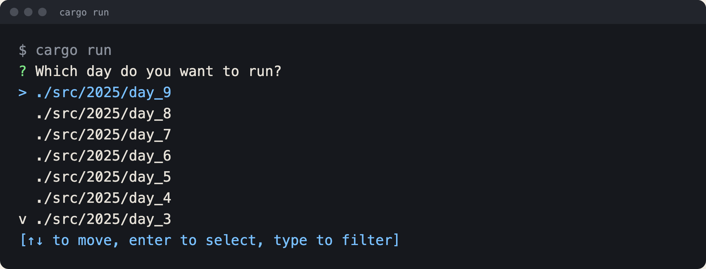

# Advent of Code 2025 in Rust

Solutions to [Advent of Code 2025](https://adventofcode.com/2025), days 1 to 9, written in Rust. One `cargo run` opens a menu of the solved days. Pick a day, and it reads your puzzle input and prints the answers.

Puzzle inputs are not in this repository. The puzzle author asks people not to share them, so you add your own input file next to each solution before you run that day.



## Run a day

You need Rust 1.85 or newer (the crate uses the 2024 edition).

```sh
git clone https://github.com/trebeljahr/advent-of-code.git
cd advent-of-code
cargo run
```

Run it from the repository root. The menu lists the folders in `./src/2025`, and each solution opens its input by a path relative to the root. Use the arrow keys or type to filter, then press Enter.

## Puzzle inputs

Sign in on adventofcode.com, open a day's input page and save it under the file name in the table. Git ignores every `.txt` file in the day folders, so your inputs stay on your machine.

| Day | Puzzle | Input file |
| --- | --- | --- |
| 1 | [Day 1](https://adventofcode.com/2025/day/1) | `src/2025/day_1/password-rotation.txt` |
| 2 | [Day 2](https://adventofcode.com/2025/day/2) | `src/2025/day_2/invalid-ids.txt` |
| 3 | [Day 3](https://adventofcode.com/2025/day/3) | `src/2025/day_3/joltage-input.txt` |
| 4 | [Day 4](https://adventofcode.com/2025/day/4) | `src/2025/day_4/paper.txt` |
| 5 | [Day 5](https://adventofcode.com/2025/day/5) | `src/2025/day_5/ingredients.txt` |
| 6 | [Day 6](https://adventofcode.com/2025/day/6) | `src/2025/day_6/math.txt` |
| 7 | [Day 7](https://adventofcode.com/2025/day/7) | `src/2025/day_7/teleporter.txt` |
| 8 | [Day 8](https://adventofcode.com/2025/day/8) | `src/2025/day_8/junction-boxes.txt` |
| 9 | [Day 9](https://adventofcode.com/2025/day/9) | `src/2025/day_9/red-tiles.txt` |

## Project structure

```text
src/
├── main.rs                # the day menu and the dispatch to each day
├── 2025/
│   ├── mod.rs             # registers one module per day
│   └── day_N/solution.rs  # one solution per day, entry point `solution()`
└── utils/file_reader.rs   # reads an input file into lines
```

To add a day, create `src/2025/day_N/solution.rs` with a `pub fn solution()`, register it in `src/2025/mod.rs`, and add a branch for `day_N` in `run_day_of_choice` in `src/main.rs`.

The only dependency is [inquire](https://crates.io/crates/inquire), which draws the menu.

## License

The code is licensed under the [GNU Affero General Public License v3.0 or later](LICENSE). Images and art made by Rico Trebeljahr are © Rico Trebeljahr, all rights reserved. Third-party assets keep their own licences. Advent of Code puzzle text and inputs belong to Advent of Code and are not part of this repository.

Support Rico's work: [ricos.site/donate](https://ricos.site/donate)
